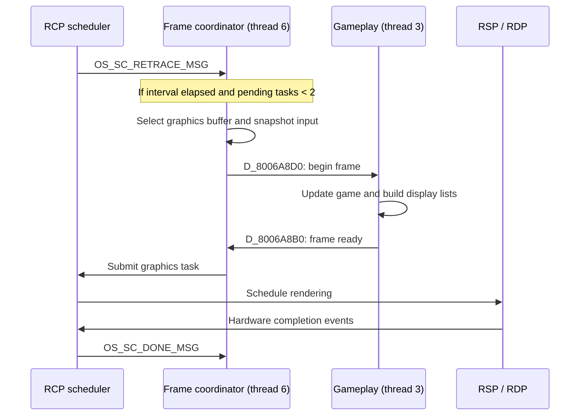

# Game architecture

## Boot

1. The console's boot firmware and cartridge bootstrap load the game's initial
   code into RAM and transfer control to its entry point. The game-side trace
   starts at [func_80000400_1000](src.us/core/entry.s): it clears the initial BSS
   region, sets the stack pointer, and jumps to
   [func_8000EF10_FB10](src.us/core/FD80.c).
2. `func_8000EF10_FB10` clears the remaining working-memory region, calls
   `osInitialize`, then creates and starts thread 1 at
   [func_8000EFB8_FBB8](src.us/core/FD80.c), initially at priority 10.
3. Thread 1 clears the framebuffer, creates the libultra VI manager, selects a
   TV-system-dependent video mode, and sets the initial framebuffer. It creates
   three application threads, initializes their message queues through
   [func_8000F218_FE18](src.us/core/FD80.c), and creates the PI manager for ROM DMA.
4. Thread 1 starts thread 6, whose entry point is
   [func_8000F6B0_102B0](src.us/core/FD80.c), then threads 7 and 3. Finally it lowers
   its own priority to zero and spins forever as the idle thread. Since it was
   initially higher priority than those three threads, they normally start
   executing when it lowers its priority.

### Persistent threads and loops

Higher numeric priorities take precedence. These are CPU threads, not RCP tasks.

| Thread | Priority | Entry / role |
|---|---:|---|
| 1 | 10, then 0 | Boot setup, then the idle loop in [func_8000EFB8_FBB8](src.us/core/FD80.c). |
| 6 | 8 | Application frame coordinator, [func_8000F6B0_102B0](src.us/core/FD80.c). Receives retrace, graphics-completion, and pre-reset messages. |
| 7 | 5 | Controller/EEPROM service, [func_80002EF8_3AF8](src.us/core/1050.c). Repeatedly reads controllers and services save-data requests. |
| 3 | 4 | Frontend/gameplay execution, starting at [func_8000FE50_10A50](src.us/core/10A20.c). Runs the active overlay's loops. |
| 10 | 15 | Controller accessory/rumble service, [func_80000ED4_1AD4](src.us/core/1050.c), created during thread 7's initialization. Waits for commands. |
| 4 | 12 | Libultra RCP scheduler, created by [osCreateScheduler](src.us/libultra/sched.c). Handles VI, SP, and DP events and schedules audio/graphics tasks. |
| 5 | 10 | Audio service, [func_80000730_1330](src.us/core/1050.c). Receives scheduler retraces and generates/submits audio work. |
| VI manager | 254 | Libultra video-interface event and framebuffer management. |
| PI manager | 150 | Libultra cartridge DMA request processing. |

Thread 6 creates the RCP scheduler, prepares two graphics-task descriptors and
their framebuffers, and registers its queue `D_8006A908` as a scheduler client.
It calls [func_80012A74_13674](src.us/core/12C80.c) to initialize audio; this calls
[func_80000450_1050](src.us/core/1050.c), which creates thread 5. Thread 6 then
sends an initial startup token to `D_8006A8D0`, initializes display/stack-check
state, and enters its permanent message loop.

Thread 7's initialization creates thread 10, initializes controllers and EEPROM,
restores saved data, and signals readiness through `D_8006A8F0`. Thread 3 first
waits for the startup token, then for this controller/save initialization. It
loads the frontend overlay and calls its entry point with argument 1. Later,
overlay transitions lead into frontend, outdoor, or indoor gameplay loops on
this same thread. The outdoor entry point
[func_80070270_7F220](src.us/overlay_gameplay/outside/7F220.c) enters
[doOutsideGameplayLoop](src.us/overlay_gameplay/outside/7F220.c) for arguments 7 or 8.

Additional thread 8 instances are temporary loading workers, created through
[func_8000F190_FD90](src.us/core/FD80.c), rather than a permanent per-frame loop.

## Gameplay loop

### What triggers a frame

The RCP scheduler forwards vertical-retrace notifications to its clients as
`OS_SC_RETRACE_MSG`. A retrace is a video refresh boundary, approximately 60 Hz
on NTSC or 50 Hz on PAL; it is not a graphics-task completion notification.
The scheduler is configured with `numFields = 1`.

On each received retrace,
[func_8000F6B0_102B0](src.us/core/FD80.c):

- Increments retrace counters and monitors graphics-task stalls.
- Advances audio fades/timers and queued sounds through
  [func_80013818_14418](src.us/core/12C80.c).
- Applies a pending palette copy through
  [func_80004C34_5834](src.us/core/53F0.c).
- Determines whether to produce another game frame. It requires fewer than two
  pending graphics tasks and enough retraces since the previous produced frame.

The interval is 3 retraces when `D_80052ACA` is 0, 2, 4, or 5, except gameplay
mode 6 uses 2; otherwise it is 1. Gameplay modes 0, 4, 7, 14, and 16 override
this to 1. Finally, nonzero `D_80052ACC` overrides it to 2. Thus refresh rate and
game-frame rate are not necessarily the same: a three-retrace interval is about
20 frames/second on NTSC, before any additional stalls.

### One produced frame

The two CPU threads synchronize through message queues rather than a direct
call from the frame coordinator into gameplay:

1. **Prepare:** Thread 6 calls
   [func_8000F368_FF68](src.us/core/FD80.c) to select/reset graphics-buffer
   pointers, and [func_80003064_3C64](src.us/core/1050.c) to prepare the frame's
   controller state. Controller hardware polling itself runs in thread 7.
   It also handles pending black-screen transitions and starts CPU timing.
2. **Wake gameplay:** Thread 6 sends to `D_8006A8D0`, then blocks waiting on
   `D_8006A8B0`. The active frontend/gameplay loop consumes the begin-frame
   message. Common frontend rendering uses
   [func_800050C4_5CC4](src.us/core/53F0.c) to wait and initialize drawing state;
   the outdoor loop waits directly on the same queue.
3. **Update and draw:** In outdoor gameplay,
   [doOutsideGameplayLoop](src.us/overlay_gameplay/outside/7F220.c) processes input
   and dispatches according to `gameplayMode`. Normal mode (`1`) calls
   [func_80071F28_80ED8](src.us/overlay_gameplay/outside/7F220.c), which invokes
   rendering, player/controller processing, other gameplay systems, and
   level-overlay callbacks. Updates and display-list construction are
   interleaved, not separate universal update/render passes. Other modes select
   different paths, such as paused or transitional behaviour.
4. **Return the frame:** The outdoor loop finishes its display lists and sends
   to `D_8006A8B0`, then eventually waits for the next begin-frame message.
   Other rendering loops commonly use
   [func_8000505C_5C5C](src.us/core/53F0.c) to end the display list and send the
   same completion message. This means CPU preparation is finished, not that
   the RCP has rendered the frame.
5. **Submit rendering:** Thread 6 resumes, records CPU frame-generation time,
   and calls [func_8000F478_10078](src.us/core/FD80.c). This packages the display
   list, microcode, working buffers, completion message, and framebuffer into a
   graphics task and sends it to the RCP scheduler. Thread 6 flips its buffer
   and task indices and increments `pendingTasks`.
6. **Complete rendering:** The RCP scheduler manages RSP/RDP execution and
   framebuffer presentation. Its `OS_SC_DONE_MSG` tells thread 6 that a graphics
   task has completed. Thread 6 records task latency, decrements `pendingTasks`,
   and applies eligible deferred video-scaling changes. Two tasks can be pending;
   this does not mean two complete graphics tasks execute simultaneously.

Audio has its own retrace-driven thread and RSP tasks, so it is not limited to
the gameplay frame interval. The frame coordinator also checks stack sentinels
on each message-loop iteration. On `OS_SC_PRE_NMI_MSG`, it stops normal frame
processing, performs shutdown/reset preparation, blacks the display, destroys
selected threads, and spins awaiting reset.
